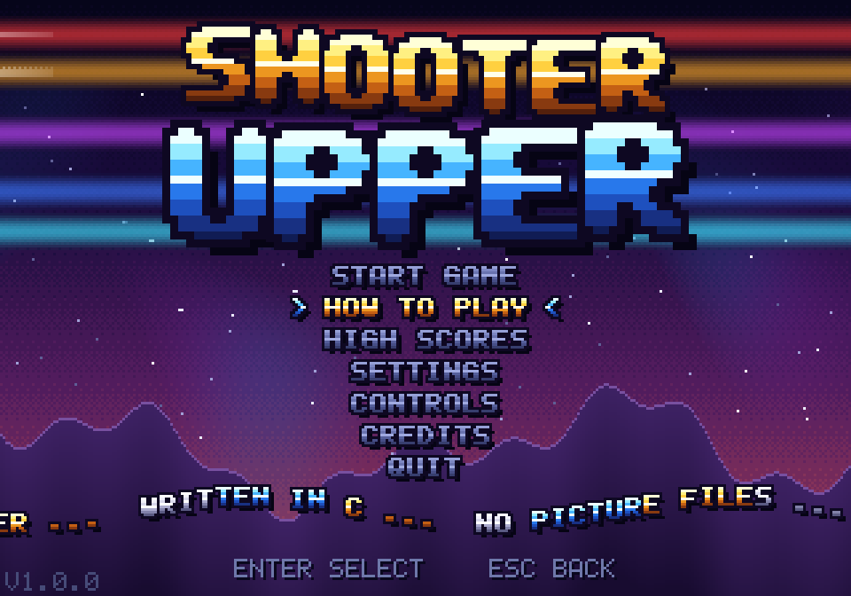
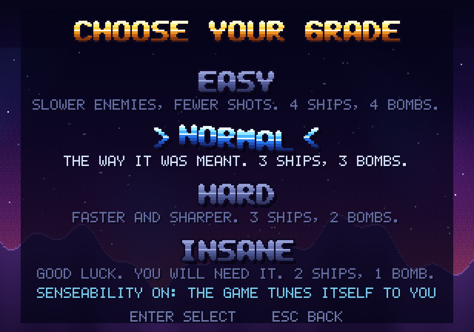
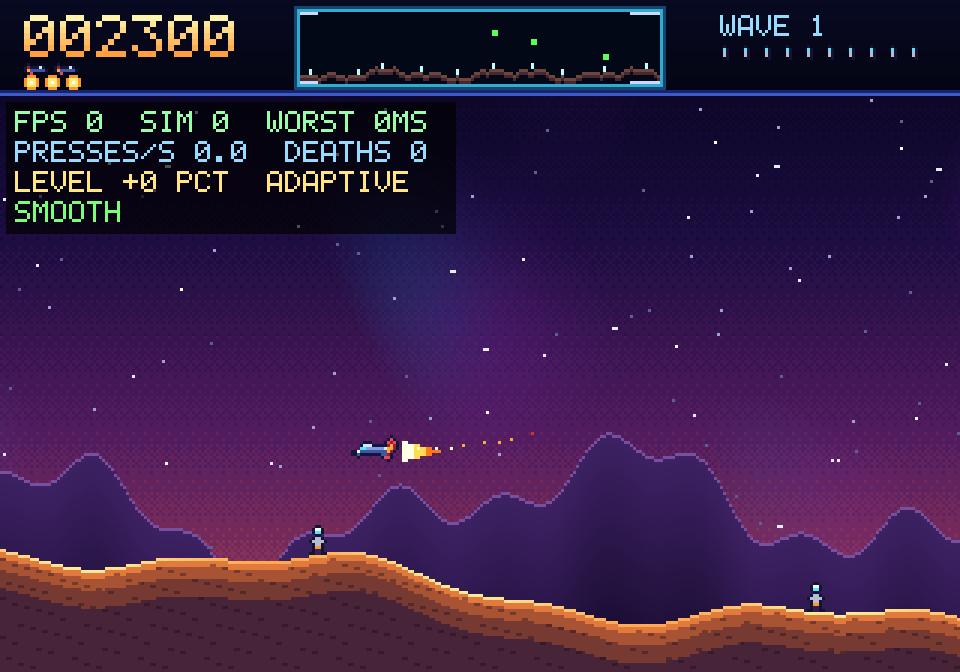

# Shooter Upper

An arcade defense shooter. Fly over a wrapping planet, shoot the aliens, and
stop them from carrying your humanoids away. 16-bit looks, 8-bit chip sound.
Every picture is drawn by code and every sound is synthesized by code, so the
game ships as one small program with no art or audio files.

Written in C11 with SDL2. Builds on Arch Linux and Ubuntu. Windows is not done yet.

| | |
|---|---|
|  |  |

## Play

    shooter-upper                 start normally
    shooter-upper --fullscreen    start fullscreen
    shooter-upper --help          all options

Keyboard (all keys can be changed in CONTROLS):

| Action        | Keys              | Pad (default)     |
|---------------|-------------------|-------------------|
| Move up/down  | Up/Down or W/S    | D-pad / left stick|
| Thrust        | Z or K            | RB / right trigger|
| Reverse       | X or L            | B / left trigger  |
| Fire          | Space or J        | A                 |
| Smart bomb    | C or I            | X                 |
| Hyperspace    | V or O            | Y                 |
| Pause         | Esc or P          | Start             |

Steering is MODERN by default: left or right (arrow keys, A/D, d-pad or left
stick) flies that way. In SETTINGS you can switch to CLASSIC, like the arcade:
then left and right do nothing, you gas with the thrust button and turn the
ship around with the reverse button.

Global keys: F11 or Alt+Enter fullscreen, F10 CRT effect, F9 Senseability
meter, F12 screenshot.

**Grades.** START GAME opens a screen with four grades: Easy, Normal, Hard and
Insane. They change enemy speed, how often they shoot, how well they aim, and
how many ships and smart bombs you start with.

**Senseability.** The game watches its own frame rate (target: a steady 60)
and how you play (button presses per second, deaths). With SENSEABILITY on, it
nudges enemy speed by at most 8 percent to suit you. Press F9 to see the
numbers. Details in `docs/SENSEABILITY.md`.

**Music.** The title song plays on every screen except the game itself. The
repository ships no song file. You have two choices:

1. Do nothing. The game plays its built-in chiptune, which is made by code.
2. Make your own song on your own machine. `docs/MUSIC.md` has the ready
   prompts for ACE-Step. Save the result as an MP3 at
   `~/.config/shooter-upper/theme.mp3` and the game uses it. Delete the file
   to go back to the chiptune.

**Idle parade.** Leave the title screen alone for 20 seconds and the whole
cast shows up, steered by an imaginary kid with a joystick.

**Problems.** If something goes wrong (no sound device, a bad song file, a
disk that cannot be written, a controller that disappears, a computer that is
too slow) the game shows a dialog that says what happened and what to try.
Everything is also written to `~/.config/shooter-upper/log.txt`.

Controllers: anything SDL2 knows as a game controller (Xbox, PlayStation,
Switch Pro, 8BitDo and so on), hot-plugging supported. Button names in the
menus follow the controller type.

Settings and high scores live in `~/.config/shooter-upper/`.

## Build

    sudo pacman -S sdl2 cmake base-devel      # Arch
    sudo apt install build-essential cmake libsdl2-dev   # Ubuntu 24.04+

    cmake -S . -B build -DCMAKE_BUILD_TYPE=Release
    cmake --build build -j
    SDL_VIDEODRIVER=dummy SDL_AUDIODRIVER=dummy ctest --test-dir build
    ./build/shooter-upper

Packages (Arch PKGBUILD, Ubuntu deb) are in `docs/BUILDING.md`.

## Credits

**Idea, direction and taste: Marko Tahvanainen.** He came up with the game,
decided what it should feel like (Defender, 16-bit looks, 80s chip sound,
Finnish Amiga scene animation, a sensor that tunes the game, an idle parade
steered by an imaginary kid), played it, said what was wrong, and generates
and wrote the song brief that players can use to make their own title song.

**Design and implementation: Claude (Anthropic).** Claude wrote the code, the
procedural art and sound, the tests and the packaging, in conversation with
Marko. The built-in chiptune is Claude's code. The ACE-Step prompts in
`docs/MUSIC.md` were written by Claude.

Third-party: SDL2 (zlib license) and minimp3 (CC0), see `third_party/README.md`.

## License

Source-available, all rights reserved. You can read it, fork it on GitHub and
build it for yourself. You cannot sell or redistribute it, or use the name,
without permission. Full text in `LICENSE`. Contributions: see
`CONTRIBUTING.md`.

## Docs

- `docs/BUILDING.md` build, test, package for Arch and Ubuntu
- `docs/MUSIC.md` the song, ACE-Step prompts, file format
- `docs/SENSEABILITY.md` what the sensor measures and does
- `docs/LEGAL.md` name, license and trademark notes (read before selling)
- `docs/STORE.md` store page text and screenshot list
- `docs/PLAN.md`, `docs/RESEARCH.md` design plan and the rules research
